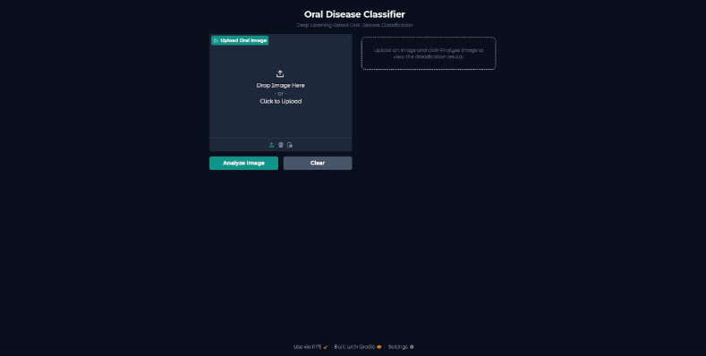
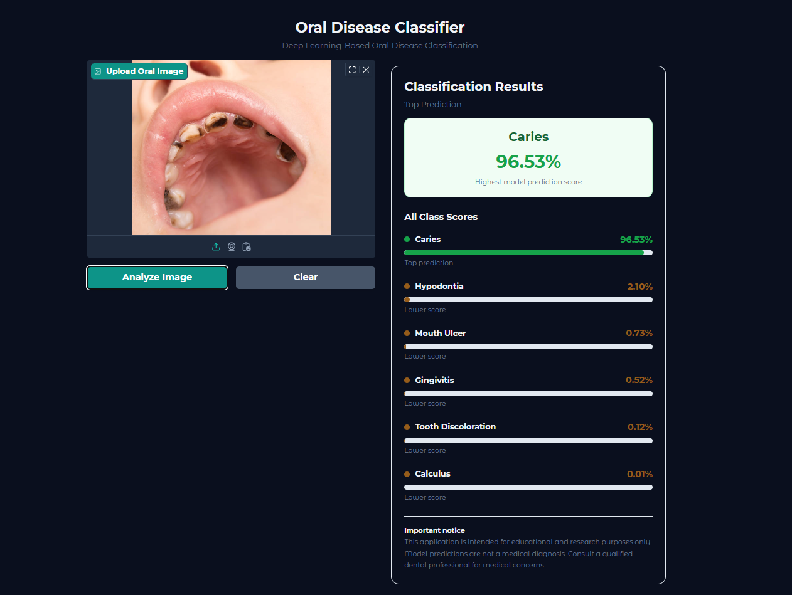

# Oral Disease Classification & Deployment

A deep learning project that classifies oral images into six categories using CNN architectures and transfer learning. The project covers data quality checks, model training and evaluation, and deployment through an interactive Gradio web application.

The final model uses **fine-tuned MobileNetV2** and achieved **92.03% test accuracy**.

## Application Demo



*The application accepts an uploaded image and displays the top prediction alongside scores for all six classes.*

### Application Screenshot



## Project Overview

The goal of this project is to explore deep learning approaches for oral image classification and deploy the trained model through a simple, interactive interface.

### Key Features

- Image quality checks and duplicate detection using MD5 hashes.
- Detection and exclusion of images with conflicting class labels.
- Stratified training, validation, and test splits.
- Image preprocessing and data augmentation using TensorFlow and Keras.
- Comparison of four CNN model configurations.
- Model evaluation using test accuracy, test loss, classification reports, and confusion matrices.
- Interactive Gradio application with prediction score visualization.

## Supported Classes

The model predicts one of the following six classes:

1. Calculus
2. Caries
3. Gingivitis
4. Hypodontia
5. Mouth Ulcer
6. Tooth Discoloration

## Dataset

The project uses the [Oral Diseases dataset on Kaggle](https://www.kaggle.com/datasets/salmansajid05/oral-diseases).

Data preparation includes filtering supported image formats, identifying exact duplicates using MD5 hashes, and excluding conflicting image labels.

The dataset was divided into training, validation, and test sets using a stratified split with `random_state=42`.

| Split | Percentage |
|---|---:|
| Training | 70% |
| Validation | 15% |
| Testing | 15% |

The training set was balanced to 400 images per class through oversampling when necessary. The validation and test sets were not oversampled.

## Methodology

### Image Preprocessing

- Resize images to 224 × 224 pixels.
- Convert images to RGB.
- Use TensorFlow `tf.data` for batching, parallel processing, and prefetching.
- Apply data augmentation, including horizontal flipping, random rotation, zoom, and contrast adjustment.

### Models Evaluated

Four model configurations were trained and compared:

- **Custom CNN:** A convolutional neural network built from scratch.
- **MobileNetV2:** A pretrained ImageNet model used for transfer learning.
- **EfficientNetB0:** A pretrained ImageNet model used for transfer learning.
- **Fine-Tuned MobileNetV2:** A MobileNetV2 model further trained by unfreezing selected layers with a lower learning rate while keeping Batch Normalization layers frozen.

Early stopping and model checkpointing were used during training.

## Model Performance

The following results were obtained on the test set.

| Model | Test Accuracy | Test Loss |
|---|---:|---:|
| **MobileNetV2 Fine-Tuned** | **92.03%** | **0.2580** |
| MobileNetV2 | 88.61% | 0.3435 |
| EfficientNetB0 | 86.91% | 0.3314 |
| Custom CNN | 75.52% | 0.6580 |

Fine-tuning MobileNetV2 improved test accuracy by approximately **3.42 percentage points** compared with the original MobileNetV2 model.

Additional evaluation included classification reports, confusion matrices, per-class F1-scores, and macro-averaged precision, recall, and F1-score.

## Web Application

The application is built with **Gradio** and uses the saved Keras model for image classification.

### How It Works

1. Upload an oral image.
2. Click **Analyze Image**.
3. View the top predicted class and its prediction score.
4. Review the scores for all six classes.
5. Clear the input to analyze another image.

The application converts the uploaded image to RGB, resizes it to 224 × 224 pixels, and passes it to the loaded model.

The displayed scores represent model outputs and should not be interpreted as confirmed diagnoses or clinically validated probabilities.

## Installation and Usage

### 1. Clone the Repository

```bash
git clone https://github.com/osmanahmedosman/oral-disease-classification-deployment.git
cd oral-disease-classification-deployment
```

### 2. Create a Virtual Environment

On Windows:

```bash
python -m venv .venv
.venv\Scripts\activate
```

### 3. Install Dependencies

```bash
pip install -r requirements.txt
```

### 4. Verify the Model File

Ensure the trained model exists at:

```text
models/oral_disease_classifier.keras
```

### 5. Run the Application

```bash
python app.py
```

Open the local URL printed in the terminal by Gradio.

## Project Structure

```text
oral-disease-classification-deployment/
├── app.py
├── requirements.txt
├── README.md
├── assets/
│   ├── app-screenshot.png
│   └── app-demo.gif
└── models/
    └── oral_disease_classifier.keras
```

## Technologies Used

- Python
- TensorFlow 2.20.0
- Keras 3.13.2
- Gradio 5.23.1
- NumPy
- Pillow
- CNNs and Transfer Learning
- MobileNetV2
- EfficientNetB0
- Image Classification

## Limitations and Disclaimer

This project is intended for educational and research purposes only. It is not a clinically validated medical diagnostic system.

Model predictions may be incorrect and should not be used as a substitute for professional dental examination or medical advice. Consult a qualified dental professional for medical concerns.

## Author

**Osman Ahmed Osman**
AI & Data Solutions Engineer

- [GitHub](https://github.com/osmanahmedosman)
- [LinkedIn](https://www.linkedin.com/in/osmanahmedosman/)
- [Kaggle](https://www.kaggle.com/osmanahmedosman)
